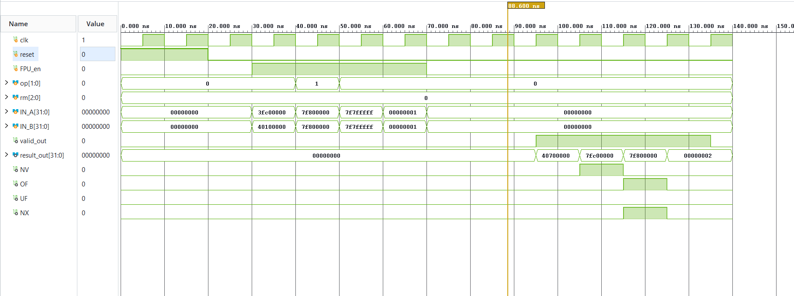

# Project11 — 5단 RISC-V CPU · 7단 FP32 FPU 설계 및 검증

기존 [Project10 CPU](../Project10_mini_CPU/)를 기반으로 IEEE 754 경계값 처리와 명령어 단위 시간 정렬을 보강한 CPU–FPU 통합 설계다. 독립 정수 기반 기준 모델, 경계값·랜덤 검사, CPU 통합 테스트 및 오류 주입으로 지원 범위를 검증한다.

## 무엇을 만들었나

- FP32 ADD/SUB/MUL의 7단 파이프라인. 매 사이클 요청을 받을 수 있다.
- ±0, subnormal, normal, ±Inf, qNaN/sNaN 분류와 canonical NaN 처리.
- RNE/RTZ/RDN/RUP/RMM 반올림, gradual underflow, NV/OF/UF/NX 결과 플래그.
- `ISOLATE=0/1`로 **같은 계산 기능**에서 산술 레지스터의 불필요한 갱신을 비교한다. 클럭을 조합논리로 잘라내는 설계가 아니라 register enable이다.
- 정수 x0는 0으로 유지하되, FP f0는 일반 레지스터처럼 읽고 쓸 수 있도록 분리했다.

현재 설계는 기존 `FADD_core`와 `FMUL_core`를 사용하는 계층형 구조다. FADD의 지수 정렬·CLA·정규화 단계와 FMUL의 곱셈·정규화 단계 뒤에 공용 [FP_rounding](src_mini_CPU/FPU_common/FP_rounding.v)을 연결한다. 특수 결과는 result/flags/illegal을 함께 지연시켜 일반 산술 결과와 같은 출력 단계에서 선택한다. 현재 빌드 대상은 `Pipeline_CPU`이며 과거 단일 사이클 예제인 `Top_CPU`는 빌드 목록에 포함하지 않는다.



일반 덧셈, Inf−Inf, overflow, 정확한 subnormal 덧셈의 네 연속 요청과 결과·예외 플래그 정렬을 보여준다. 전체 CPU 검증과 다른 반올림 모드는 별도 회귀로 검사한다.

## 재현

Python 3.10 이상과 PATH의 `iverilog`, `vvp`가 필요하다. FPGA 보드는 필요 없다.

```powershell
cd D:\My_project\Engineering_Project\verilog\Project11_Upgrade_CPU
python tools/run_regression.py
# 빠른 확인
python tools/run_regression.py --quick
# 같은 벡터를 Vivado xsim에서도 확인
.\tools\run_xsim.ps1
```

실행 산출물은 `_work/`에만 생성한다. 메모리 이미지는 자동 준비되므로 기존 Project10 파일을 읽지 않는다. 회귀는 FPU 두 버전 비교, 정확한 정수 기반 reference model 비교, CPU 기존 검사, f0/특수값 CPU 검사, 검사기 negative control을 실행한다.

Vivado 실험은 [compare_vivado.tcl](tools/compare_vivado.tcl)을 사용한다. 기준 부품 `xc7a35tcpg236-1`, 20ns 내부 클럭, OOC FPU만 비교한다. **실제 보드나 CPU 전체의 성능이 아니다.**

```powershell
& 'D:\My_project\2026.1\Vivado\bin\vivado.bat' -mode batch -source tools/compare_vivado.tcl -tclargs xc7a35tcpg236-1
```

## 문서

현재 기능 회귀는 FPU **30,626건**, 반올림·정규화 경계 **23개**, CPU **59+6개** PASS다. 잘못된 예상값과 의도적으로 주입한 RTL 반올림 버그의 실패 검출도 검사한다. **FPGA 비교는 미완료**다. 과거 Vivado가 최소 플립플롭 회로 합성에서도 종료된 기록이 있으며, 이번 수정본의 PPA 수치는 측정하지 않았다.

- [설계 명세·파이프라인·변경 이유](docs/01_design.md)
- [검증 범위와 결과 해석](docs/02_verification.md)
- [자동 회귀 결과](docs/results.json)
- [CPU–FPU 통합 설계 보고서](docs/07_submission_report.md)
- [문서·폴더 안내](docs/README.md)

## 주장하지 않는 것

전체 RISC-V F 확장, IEEE 754 전체 적합성 인증, 전체 명령어·예외 검증, 동적 반올림 `frm/fcsr`, ISA trap, FPGA 실측 전력 절감은 완료하지 않았다. CPU에는 새 플래그를 CSR에 누적하는 경로도 없다. 현재는 ADD/SUB/MUL 서브셋 실험이다. Operand isolation은 이 프로젝트만의 새로운 발명이라고 주장하지 않는다.

## 구현 기여

기존 CPU·FPU RTL을 기반으로 특수값 처리, 반올림, 예외 플래그, 파이프라인 시간 정렬과 자동 회귀검증 환경을 확장하였다. 구현 결과는 실제 RTL 시뮬레이션과 회귀시험으로 검증하였다.
