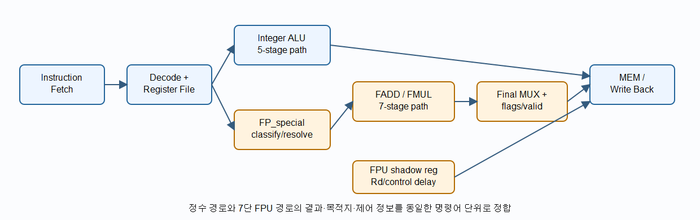
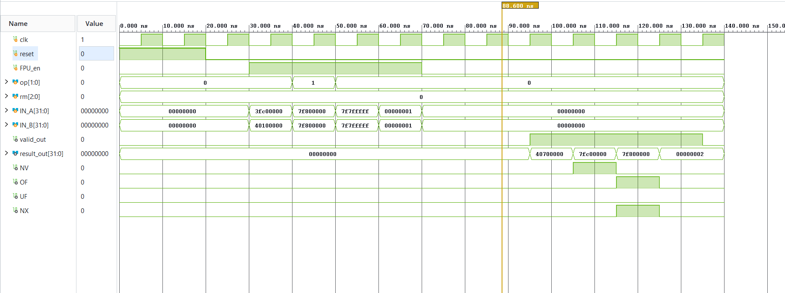

# 7단 파이프라인 단정밀도 FPU를 결합한 RISC-V 프로세서 설계 및 검증

## 초록

본 작품은 Verilog HDL로 구현한 5단 RISC-V 파이프라인 프로세서에 7단 IEEE-754 단정밀도 부동소수점 연산기를 결합한 디지털 설계이다. 정수 산술·논리·시프트·메모리·분기·점프 명령 일부와 FLW, FSW, FADD, FSUB, FMUL을 지원한다. 서로 다른 완료 시점을 갖는 정수 경로와 FPU 경로를 함께 운용하기 위해 forwarding, load-use hazard, FPU in-flight RAW hazard, 목적지 레지스터 지연 및 write-back 제어를 구현하였다.

Project11에서는 기존 유한수 중심 FPU를 확장해 signed zero, subnormal, infinity, qNaN, sNaN을 분류하고 연산별 특수 결과를 생성하였다. RNE, RTZ, RDN, RUP, RMM 다섯 반올림 모드와 NV, OF, UF, NX 예외 플래그를 추가했으며, 일반 계산 결과와 특수 결과가 동일한 명령어의 목적지 정보와 만나는 7단 시간축을 유지하였다. 독립 Python 기준 모델과 Vivado xsim을 이용해 FPU 30,626건, 반올림·정규화 경계 23건, CPU 결과 59+6개 항목을 검사했으며 현재 지원 범위에서 모두 일치하였다.

## 1. 설계 목표와 범위

목표는 단순한 부동소수점 계산 모듈이 아니라 CPU 파이프라인 안에서 명령어 의존성과 예외 정보를 잃지 않는 FPU를 설계하고 검증하는 것이다.

지원 범위는 다음과 같다.

| 구분 | 지원 내용 |
|---|---|
| 데이터 형식 | IEEE-754 binary32 단정밀도 |
| FP 메모리 | FLW, FSW |
| FP 산술 | FADD.S, FSUB.S, FMUL.S |
| 반올림 | RNE, RTZ, RDN, RUP, RMM |
| 입력 종류 | normal, subnormal, ±0, ±Inf, qNaN, sNaN |
| 플래그 | NV, OF, UF, NX |
| CPU 제어 | forwarding, stall, flush, FPU RAW 추적 |

정수↔FP 이동·변환, FMA, FDIV, FSQRT, DYN/fcsr 및 전체 ISA trap은 지원하지 않는다. 이 범위를 보고서와 검증 결과에서 구분한다.

## 2. 전체 구조

프로세서는 IF, ID, EX, MEM, WB의 5단 정수 파이프라인을 사용한다. ID 단계에서 명령어와 레지스터를 해석하고 EX 단계에서 정수 ALU 또는 FPU를 시작한다. 정수 결과는 기존 경로로 이동하고, FP 결과는 7단 FPU를 통과한다. FPU shadow register는 FPU 결과가 나올 때까지 목적지 Rd와 write-back 제어를 같은 시간만큼 지연한다.

FPU 입력은 두 경로로 나뉜다. `FP_special`은 두 피연산자를 분류해 계산 없이 결정할 수 있는 NaN, infinity, zero 및 illegal 결과를 만든다. 일반 유한수는 FADD/FSUB 또는 FMUL 코어에서 계산한다. 특수 결과를 즉시 출력하면 목적지 Rd와 어긋나므로 `{special, illegal, flags, result}` packet으로 묶어 일반 결과와 동일한 단계만큼 전달하고 마지막 MUX에서 선택한다.

## 3. FADD/FSUB 및 FMUL 데이터 경로

FADD/FSUB은 두 지수를 비교하고 작은 가수를 오른쪽으로 이동해 소수점 위치를 맞춘다. 이동하며 버려지는 비트는 sticky 정보로 보존한다. 이후 가수 덧셈 또는 2의 보수 뺄셈, magnitude 복원, leading-zero 기반 정규화, 지수 보정과 반올림을 수행한다. normal 입력에만 hidden bit 1을 붙이며 subnormal은 hidden bit 0과 effective exponent 1로 계산한다.

FMUL은 두 24비트 유효숫자를 곱해 48비트 결과를 만들고, `effective_A + effective_B - 127`을 기준으로 지수를 계산한다. leading bit 위치에 맞춰 가수를 정규화하며 결과 지수가 normal 범위 아래로 내려가면 right-shift-jam으로 subnormal 후보를 만든다.

두 연산 코어는 공용 `FP_rounding` 모듈을 사용한다. 이 모듈은 LSB, Guard, Round, Sticky를 이용해 반올림 여부를 판단하고, 25비트 임시 합으로 fraction carry를 보존한다. carry가 발생하면 지수를 증가시키고 최종 `{SIGN, EXPO, FRAC}`를 포장한다. overflow 결과는 반올림 모드와 부호에 따라 infinity 또는 최대 finite가 되며, underflow는 반올림 후 tiny이면서 inexact인 경우로 판단한다.

## 4. 특수값과 예외 처리

| 조건 예시 | 결과 | 플래그 |
|---|---|---|
| qNaN 입력 | canonical qNaN | NV=0 |
| sNaN 입력 | canonical qNaN | NV=1 |
| Inf−Inf | canonical qNaN | NV=1 |
| 0×Inf | canonical qNaN | NV=1 |
| finite overflow | rm·부호에 따른 Inf 또는 max finite | OF=1, NX=1 |
| 정확한 subnormal | subnormal 결과 | UF=0, NX=0 |
| tiny and inexact | subnormal 또는 zero | UF=1, NX=1 |

반대 부호의 정확한 0 합은 RDN에서 −0, 나머지 모드에서 +0으로 처리한다. 곱셈 zero 결과의 부호는 두 입력 부호의 XOR이다.

## 5. 연산 격리 실험

`ISOLATE=1`에서는 특수값 요청과 invalid 구간에 일반 산술 입력 레지스터를 유지하고 코어 enable을 차단한다. `ISOLATE=0/1` 두 설계의 유효 결과와 플래그가 모두 같음을 회귀 테스트로 확인했다. 500개의 특수값 집중 입력에서 관찰한 a1/b1 비트 전환은 기본 구조 10,315회, 격리 구조 0회였다.

이 수치는 산술 입력 레지스터의 전환 감소 증거이며 전체 FPU 전력 절감률이 아니다. 분류기, packet 파이프라인과 clock tree는 계속 동작한다. 실제 전력 주장을 위해서는 구현 netlist와 대표 workload의 SAIF가 필요하다.

## 6. 검증 방법

Python 기준 모델은 FP32 값을 `2^-149` 단위의 정수로 바꾸고 정확한 정수 연산의 몫과 나머지로 반올림한다. RTL 파이프라인 알고리즘을 그대로 복사한 모델이 아니므로 동일 구현 오류를 반복할 가능성을 낮췄다.

| 검증 계층 | 구성 | 결과 |
|---|---:|---:|
| FPU 경계값 조합 | 20종 × 연산 3종 × rm 5종 | 6,000건 포함 |
| 고정 seed 랜덤 | FP32 입력·연산·반올림 | 20,000건 포함 |
| 상쇄·sticky·지수 경계 | 표적 벡터 | 4,800건 포함 |
| reset·bubble·illegal 포함 최종 FPU 비교 | 유효 출력 기준 | 30,626 PASS |
| 반올림·정규화 직접 검사 | 경계 단위 테스트 | 23 PASS |
| CPU 기존 통합 프로그램 | 정수 29 + FP 30 레지스터 | 59 PASS |
| CPU 특수값·f0 추가 검사 | f0, NaN, subnormal, x0 | 6 PASS |

검사기는 결과 비트뿐 아니라 7단 valid 정렬, error, sign/ZF, NV/OF/UF/NX와 `UF → NX` 관계를 확인한다. expected result 한 비트를 고의로 바꾼 negative control과 RDN 논리를 고의로 손상한 RTL mutation도 실패를 검출했다.

## 7. 대표 파형

위 그림은 실제 Vivado xsim 화면 캡처다.

대표 파형은 네 요청을 연속으로 접수한다.

1. `1.5 + 2.25` → `3.75`
2. `+Inf - +Inf` → canonical qNaN, NV
3. `max finite + max finite` → +Inf, OF/NX
4. `minimum subnormal + minimum subnormal` → 정확한 `0x00000002`

입력 순서와 출력 순서가 같고, 각 결과가 7번째 상승 에지에서 valid와 함께 나타난다. 파형 전용 테스트도 네 결과를 자체 검사하여 `REPORT WAVEFORM PASS 4`로 종료된다.

## 8. 한계와 후속 계획

현재 Vivado xsim 기능 검증은 완료했지만 FPGA 합성·배치배선은 완료하지 못했다. FPU뿐 아니라 최소 플립플롭 회로도 RTL elaboration 이후 exit code 1로 종료되어 현재 증거만으로 설계 크기나 메모리 부족을 원인으로 판단하지 않는다. 따라서 LUT, FF, Fmax, critical path와 전력 수치는 제시하지 않는다.

후속 단계는 Vivado 합성 환경을 정상화하고 동일 FPGA와 제약에서 `ISOLATE=0/1`을 비교하는 것이다. 추가 구조 실험으로는 양방향 CLA 두 개를 동시에 사용하는 현재 FADD와 magnitude 선결정 후 CLA 하나를 사용하는 FADD의 기능 동등성 및 PPA trade-off를 비교할 수 있다. 이 실험은 현재 제출본의 검증된 기준 설계를 변경하지 않고 별도 버전으로 수행한다.

## 9. 결론

본 작품은 서로 다른 지연의 정수·부동소수점 실행 경로를 하나의 CPU에서 정합하고, IEEE-754 특수값과 다섯 반올림 모드를 실제 파이프라인 결과 및 예외 플래그에 연결하였다. 유한 표본이라는 한계는 있으나 독립 기준 모델, 경계·랜덤·CPU 통합 테스트, negative control과 RTL mutation을 함께 사용해 단순 예제 입력보다 강한 재현 가능한 검증 근거를 마련하였다.

## 참고 및 구현 기여

- RISC-V Unprivileged ISA의 single-precision floating-point 규칙
- IEEE-754 binary32 표현 및 반올림 개념
- Xilinx Vivado Simulator 2026.1
- Icarus Verilog와 Python 독립 reference model

Project11에서는 기존 CPU/FPU 구조에 특수값 처리, 반올림, 예외 플래그, 파이프라인 시간 정렬과 회귀검증 환경을 추가하였다. 각 기능은 RTL 기능 시뮬레이션과 자동 회귀시험 결과를 기준으로 검증하였다.
