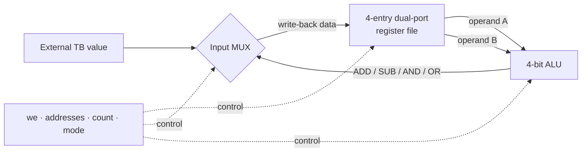

# Project 8: Register–ALU Feedback System

[← Project 7](../Project7_Shift_register/README.md) · [Verilog projects](../README.md) · [Design notes](memo/정리.md) · [Background](memo/배경지식.md) · [Error log](memo/error_log.md) · [Next: Project 9 →](../Project9_mini_processer_using_FSM/README.md)

## 1. Introduction & Design Architecture

### 1. Introduction

Project 8 combines the arithmetic blocks from the earlier projects with a register file and a MUX. A four-entry dual-port register file supplies two operands to the ALU, and the MUX selects either an external test value or the ALU result as the next value to write.

This closes the data path for the first time:

```text
register read → ALU operation → MUX selection → register write-back
```

The structure is a small preview of a CPU execute/write-back path. The two read ports act like `Rs1` and `Rs2`, while the feedback path returns the calculated result to storage.

### 2. Design Architecture




## RTL Design

| Module | Responsibility |
|---|---|
| `Top_system.v` | Connects the register file, ALU, and feedback MUX |
| `dual_port_reg.v` | Four entries, one synchronous write port, two asynchronous read ports |
| `MUX.v` | Selects external initialization data or the ALU result |
| `Top_system_tb.v` | Writes operands, selects read addresses, and exercises four ALU modes |

The project reuses arithmetic modules from Projects 2–5 through `Top_system.f` instead of copying their implementations.

### 1) Dual-port register file

```verilog
always @(posedge clk or posedge reset) begin
    if (reset)
        for (i=0; i<4; i=i+1) mem[i] <= 0;
    else if (we)
        mem[w_add] <= din;
end

assign dout1 = mem[r_add1][N-1:0];
assign dout2 = mem[r_add2][N-1:0];
```

Writes change state only on a clock edge. Reads are combinational, allowing both ALU operands to be selected at the same time.

The write port is synchronous, so `mem[w_add]` changes only at a clock edge. The two read ports are combinational, so the ALU can observe both operands at the same time.

### 2) Input MUX

```verilog
assign din = count ? alu_v : {1'b0, TB_v};
```

`count=0` loads an external value; `count=1` closes the feedback loop and stores an ALU result.

### 3) Top Module

`Top_system.v` instantiates `dual_port_reg`, `alu_Nbit`, and `MUX`. The top module does not perform the operation itself; it wires each module's output to the next module's input.

| File | Role |
|---|---|
| `Top_system.v` | Register file, ALU, and feedback MUX integration |
| `dual_port_reg.v` | Four entries, one synchronous write port, two asynchronous read ports |
| `MUX.v` | External initialization value / ALU result selection |
| `Top_system_tb.v` | Operand write, address selection, and four-mode verification |

The file list reuses arithmetic modules from Projects 2–5 instead of copying their implementations.

## 3.TestBench

The testbench first writes 4 to register 0 and 1 to register 1. It then selects those two addresses and changes `mode` to exercise ADD, SUB, AND, and OR.

The important timing rule is that `we`, `w_add`, and `TB_v` must be stable before the positive clock edge. If the testbench changes them on the same edge at which the DUT samples them, simulator scheduling can make the observed write ambiguous. This was the cause of the first debugging case in the [error log](memo/error_log.md).

Run from the `verilog/` directory because the file list uses paths relative to that location.

```bash
iverilog -g2012 -o project8.out -f Project8_Register_Topsystem/Top_system.f
vvp project8.out
gtkwave top_sys.vcd
```

## 4.WaveForm Verification

The test loads register 0 with 4 and register 1 with 1, then applies all four ALU modes.

| Mode | Operation | Expected | Observed |
|---|---|---:|---:|
| `00` | ADD | 5 | 5 |
| `01` | SUB | 3 | 3 |
| `10` | AND | 0 | 0 |
| `11` | OR | 5 | 5 |


The waveform shows `mem[0]=04`, `mem[1]=01`, followed by ALU/MUX values `05 → 03 → 00 → 05`.

During debugging, `dout2=4` initially looked like corrupted data. The actual cause was that both read ports still selected address 0. After `r_add2=1`, the second output correctly became 1. The waveform therefore had to be read in the order **stored value → selected address → output**, rather than judging the output alone.

## 5. Conclusion

Project 8 changed separate arithmetic and storage blocks into one connected datapath. The main result is not only that ADD, SUB, AND, and OR produced the correct values, but that the entire path—two register reads, ALU execution, MUX selection, and synchronous write-back—was visible in one waveform.

The project added the following concepts:

- multi-port storage rather than a single standalone register
- a closed register → execute → write-back data path
- separation of data, address, control, and clock timing
- hierarchical reuse of arithmetic modules from earlier projects
- the architectural bridge to [Project 9](../Project9_mini_processer_using_FSM/README.md), where an FSM controls the operation sequence

**Remaining improvements**

- The test covers registers 0 and 1, not the full four-entry address space.
- Verification is waveform-based rather than self-checking.
- The design mixes N-bit operands with N+1-bit carry-inclusive storage.
- Some testbench assignments still occur at a positive edge and should be moved away from the DUT sampling event.
