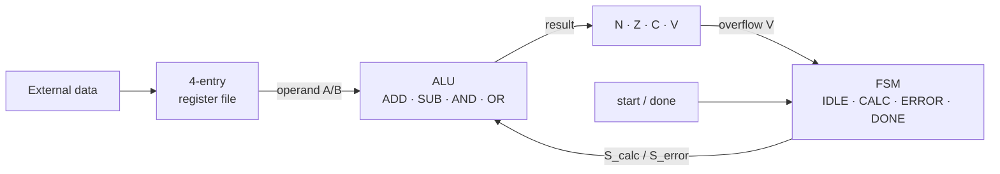
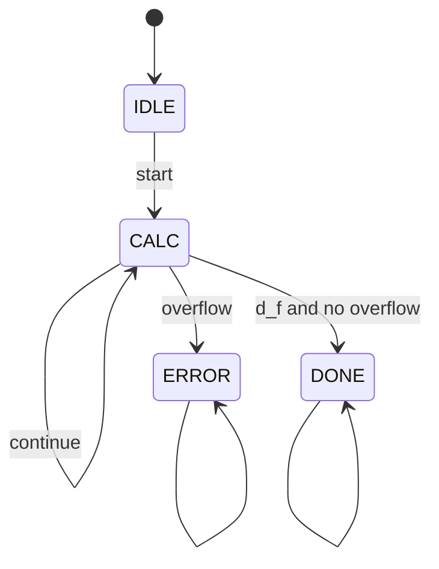

# Project 9: FSM-Controlled Mini Processor

[← Project 8](../Project8_Register_Topsystem/README.md) · [Verilog projects](../README.md) · [Design notes](memo/정리.md) · [Background](memo/배경지식.md) · [Error log](memo/error_log.md) · [Next: Project 10 →](../Project10_mini_CPU/README.md)

## 1. Introduction & Design Architecture

### 1. Introduction

Project 9 adds a control path to the datapath built in Project 8. A finite-state machine decides when calculation is enabled, detects overflow, and moves the system into `ERROR` or `DONE`. The datapath reads two operands from a small register file and performs ADD, SUB, AND, or OR.

This is a **mini processor**, not a complete ISA CPU. It has no program counter, instruction memory, or decoder. The goal is to learn the separation between datapath and control before building Project 10.

### 2. Design Architecture





The FSM is the controller: it does not calculate the arithmetic result itself. It observes `start`, `d_f`, and overflow `V`, then produces control signals such as `S_calc`. The register file and ALU form the datapath.

## RTL Design

### 1) Register file

`m_register.v` stores four values, writes one selected address on a clock edge, and exposes two selected values at the same time. These outputs become the two ALU operands.

### 2) Adder and subtracter

`m_adder.v` forms a parameterized ripple-carry adder. `m_subtracter.v` performs two's-complement subtraction by inverting the second operand and applying the initial carry-in.

The carry path must be continuous from the least significant stage to the most significant stage. A missing connection makes the next stage's `cin` unknown, which then spreads `x` through the remaining result bits.

### 3) ALU

`m_ALU.v` selects ADD, SUB, AND, or OR with `mode`. Its architectural output is enabled while the controller asserts `S_calc`. The ALU also produces `N`, `Z`, `C`, and `V` status flags.

| Flag | Meaning | Valid operation |
|---|---|---|
| `Z` | result equals zero | all operations |
| `N` | negative result | subtraction |
| `C` | unsigned carry-out | addition |
| `V` | signed overflow | addition/subtraction |

Carry and overflow are different: carry describes an unsigned bit leaving the word, while overflow means a signed result left the representable range.

### 4) FSM

The controller uses four states: `IDLE`, `CALC`, `ERROR`, and `DONE`.

```verilog
CALC: begin
    if (V)         next_state = ERROR;
    else if (d_f)  next_state = DONE;
    else           next_state = CALC;
end
```

Overflow has priority over completion because the `if` branch is checked first. In the current design, `ERROR` and `DONE` are terminal until reset.

### 5) Top Module

| Module | Responsibility |
|---|---|
| `m_top_module.v` | Integrates the register file, ALU, and FSM |
| `m_FSM.v` | Stores state, computes transitions, and generates state outputs/flags |
| `m_ALU.v` | Gates execution with `S_calc` and selects one of four operations |
| `m_adder.v` | Parameterized ripple-carry addition |
| `m_subtracter.v` | Two's-complement subtraction using the same full-adder primitive |
| `m_register.v` | Four-entry storage with one write and two read ports |
| `mini_processer1_tb.v` | Loads operands and exercises normal and overflow behavior |

`m_top_module.v` connects the register file, ALU, and FSM. This hierarchy makes the ownership clear: the FSM controls, the ALU calculates, and the register file stores operands.

## 3.TestBench

The testbench uses three directed input pairs. One verifies the normal values of all four operations, and two deliberately cross the signed 4-bit range to verify addition and subtraction overflow separately.

Run from the `verilog/` directory because the file list uses paths relative to that location.

```bash
iverilog -g2012 -o project9.out -f Project9_mini_processer_using_FSM/m_processer1.f
vvp project9.out
gtkwave m_pro.vcd
```

## 4.WaveForm Verification

### Normal path — `a=4`, `b=1`


| Mode | Operation | Expected | Observed |
|---|---|---:|---:|
| `00` | ADD | 5 | 5 |
| `01` | SUB | 3 | 3 |
| `10` | AND | 0 | 0 |
| `11` | OR | 5 | 5 |

### Addition overflow — `a=3`, `b=5`


`3 + 5 = 8` exceeds the 4-bit signed range `-8..7`; `V` asserts and the controller enters `ERROR`.

### Subtraction overflow — `a=2`, `b=4'hA (-6 signed)`


The addition `2 + (-6) = -4` is representable, while `2 - (-6) = 8` is not. The waveform separates bit-pattern arithmetic from signed overflow interpretation.

The three waveforms show both correct arithmetic and correct control response. A previous failure that looked like a mode-selection problem was actually a state transition: the preceding ADD had asserted `V`, so the FSM had already entered `ERROR` before SUB was selected. The complete reconstruction is in the [error log](memo/error_log.md).

## 5. Conclusion

Project 9 adds a controller to the closed datapath from Project 8. The important result is learning that a wrong output can originate in either path: the datapath may calculate incorrectly, or the controller may disable a correct datapath result. Debugging therefore followed signals across the boundary—operand, carry chain, flag, current state, and control output.

The following concepts connect directly to Project 10:

| Project 9 concept | Project 10 counterpart |
|---|---|
| FSM controller | decoder, hazard, and pipeline control |
| dual-read register file | `Rs1` / `Rs2` operand fetch |
| ALU status flags | branch and arithmetic conditions |
| `S_calc` execution enable | stage enable, stall, and flush |
| error state | exception/trap control concept |
| ripple-carry arithmetic | CPU ALU and FPU internal datapaths |

Project 10 replaces manual mode selection with encoded instructions, adds a PC and memories, and pipelines execution. The control/datapath separation learned here remains the same at a larger scale.

**Remaining improvements**

- `mem[3]` is not reset because the current loop stops at `i<3`.
- `S_error` is not explicitly connected into the ALU instance.
- Several expressions hard-code four-bit positions despite the `W` parameter.
- `ERROR` and `DONE` require reset before another operation.
- The testbench is waveform-based and changes some controls on a positive edge.

Details are recorded in the [error log](memo/error_log.md).
