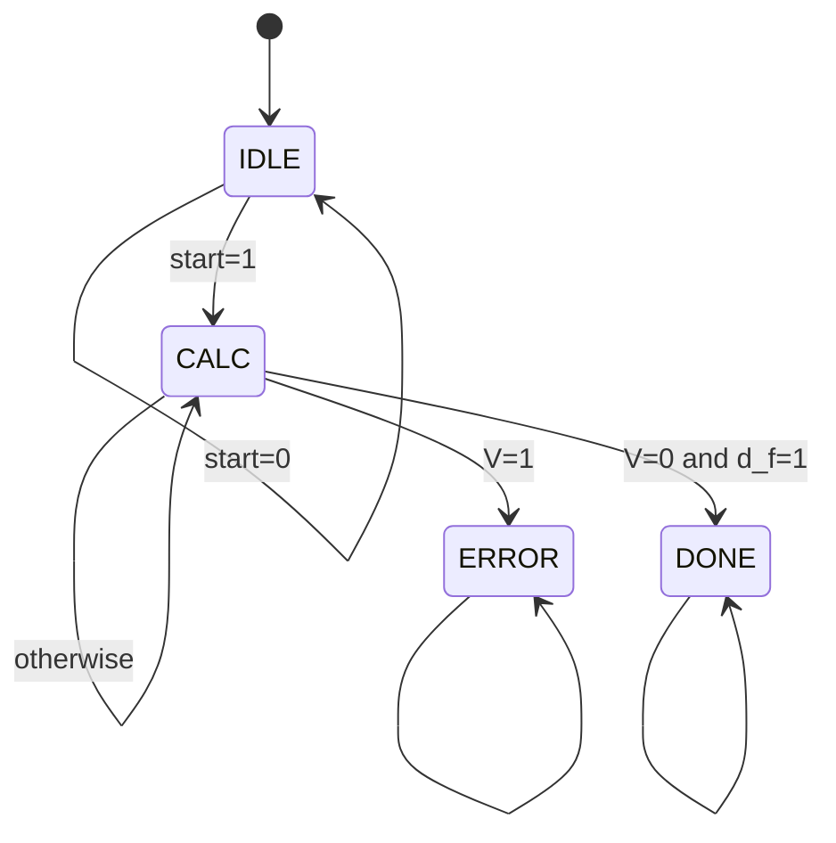

# Project 9 — 배경지식

[← Project 9 README](../README.md) · [Design notes](정리.md) · [Error log](error_log.md)

주제: **FSM, 제어 경로와 데이터 경로, Moore 출력, 상태 플래그, signed overflow, terminal state**

---

## 1. 데이터패스만으로 부족한 이유

Project 8은 register file, ALU, MUX를 연결했지만 사람이 테스트벤치에서 `we`, 주소, `mode`, `count`를
정확한 순서로 바꿔야 했다. 회로가 “지금 입력을 받는 중인지, 계산 중인지, 끝났는지” 스스로 기억하지 못했다.

FSM(Finite State Machine)은 이 순서를 상태로 기억하는 제어기다.

```text
datapath: 실제 값을 저장하고 계산한다
control : 지금 어떤 동작을 허용할지 결정한다
```

이 프로젝트에서는 register와 ALU가 datapath이고, `m_FSM`이 control path다.

---

## 2. FSM의 세 부분

동기 FSM은 보통 세 블록으로 나뉜다.

### 1) 상태 레지스터

```verilog
always @(posedge clk or posedge reset) begin
    if (reset) curr_state <= IDLE;
    else       curr_state <= next_state;
end
```

현재 상태를 플립플롭에 저장한다. 상태가 실제로 바뀌는 시점은 상승 에지다.

### 2) 다음 상태 조합 논리

```verilog
case (curr_state)
    IDLE : next_state = start ? CALC : IDLE;
    CALC : next_state = V ? ERROR : d_f ? DONE : CALC;
    ERROR: next_state = ERROR;
    DONE : next_state = DONE;
endcase
```

현재 상태와 입력으로 다음 상태를 미리 계산한다.

### 3) 출력 조합 논리

```verilog
S_idle=0; S_calc=0; S_error=0; S_done=0;
case (curr_state)
    IDLE : S_idle=1;
    CALC : S_calc=1;
    ERROR: S_error=1;
    DONE : S_done=1;
endcase
```

모든 출력을 먼저 0으로 초기화하고 현재 상태 하나만 1로 만든다. 이 기본값이 없으면 이전 상태의 출력이
남는 latch가 생길 수 있다.

---

## 3. Moore와 Mealy

| 형태 | 출력이 의존하는 것 | 특징 |
|---|---|---|
| Moore | 현재 상태 | 출력이 상태 레지스터를 거쳐 안정적 |
| Mealy | 현재 상태 + 입력 | 입력 변화에 바로 반응, 빠르지만 글리치 주의 |

`S_idle/S_calc/S_error/S_done`은 현재 상태만 보고 결정되므로 Moore 출력이다. 반면 `next_state`는
`start`, `V`, `d_f`를 보므로 상태 전이 조건은 입력에 의존한다.



ERROR와 DONE은 reset 전까지 빠져나오지 않는 terminal state다. 단발 작업에는 단순하지만 여러 계산을
연속 수행하려면 IDLE 복귀 조건이 필요하다.

---

## 4. 상태가 ALU를 제어하는 방식

ALU는 `S_calc=1`일 때만 mode를 실행한다.

```verilog
result = 0;
C_cout = 0;
N_cout = 0;

if (S_error)
    result = 0;
else if (S_calc)
    case (mode)
        2'b00: result = add_re;
        2'b01: result = sub_re;
        2'b10: result = a & b;
        2'b11: result = a | b;
    endcase
```

이것은 ALU에 신입사원 출입증을 주는 것과 같다. mode라는 업무 지시가 있어도 `S_calc` 허가가 없으면
업무를 수행하지 않는다. Project 9의 `mode=01에서 결과가 0` 문제도 mode 자체가 아니라 직전 overflow로
FSM이 ERROR에 들어가 `S_calc` 허가를 회수했기 때문이었다.

---

## 5. carry와 overflow는 다르다

둘 다 덧셈에서 나오지만 의미가 다르다.

### Carry (`C`)

가장 높은 비트 밖으로 나간 올림수. 주로 **unsigned** 연산에서 의미가 있다.

```text
4'b1111 + 4'b0001 = 1_0000
                       ↑ carry
```

### Overflow (`V`)

고정 비트폭의 **signed** 범위를 넘었는지 나타낸다. 4비트 signed 범위는 -8~7이다.

덧셈 overflow:

```verilog
(a_sign == b_sign) && (result_sign != a_sign)
```

감산 overflow:

```verilog
(a_sign != b_sign) && (result_sign != a_sign)
```

예를 들어 `3 + 5 = 8`은 unsigned로는 carry 없이 표현되지만, 4비트 signed에서는 `1000=-8`로
해석되므로 overflow다. 반대로 carry가 발생해도 signed overflow가 아닐 수 있다.

---

## 6. N, Z, C, V 플래그

| Flag | 의미 | 이 프로젝트의 조건 |
|---|---|---|
| `Z` | 결과가 0 | `result == 0` |
| `N` | 음수 결과 | 감산 mode에서 result MSB |
| `C` | unsigned carry | 덧셈 mode에서 최종 carry |
| `V` | signed overflow | 덧셈/감산 sign 규칙 |

플래그는 모든 연산에서 의미가 같지 않다. `N`은 감산에서, `C`는 덧셈에서만 통과시키도록 mode로
게이팅한다. 그렇지 않으면 이전 연산의 플래그가 다음 mode에도 남아 의미 없는 상태가 된다.

---

## 7. 2의 보수 감산과 `cin`

뺄셈은 덧셈기로 구현한다.

```text
A - B = A + (~B) + 1
```

`~B`만 더하면 1이 빠지므로 `cin=1`이 필수다. 따라서 감산 mode에서 테스트벤치가 `cin=1`을 준비한다.
carry chain은 다음처럼 이어진다.

```text
cin → FA[0] → FA[1] → ... → FA[W-1] → cout
```

한 연결이 `x`이면 뒤 단계가 모두 `x`가 된다. [error log E03](error_log.md)은 이 체인을 내부 비트까지
파형에 올려 끊긴 위치를 찾은 과정이다.

---

## 8. FSM 디버깅 방법

결과가 이상할 때 mode와 result만 보면 상태 전이 원인을 놓치기 쉽다. 다음 신호를 한 화면에 둔다.

1. `curr_state`, `next_state`
2. `start`, `d_f`, `V`
3. `S_idle`, `S_calc`, `S_error`, `S_done`
4. operand `a/b`, mode, ALU result
5. `N/Z/C/V`

그리고 “이 에지 직전 next_state는 무엇이었나 → 에지 뒤 curr_state가 무엇이 됐나”를 읽는다.
FSM은 순차적으로 움직이므로 현재 출력의 원인이 한 사이클 앞에 있을 수 있다.

---

## 9. 용어 정리

| 용어 | 뜻 |
|---|---|
| **FSM** | 유한한 상태와 전이 조건으로 동작 순서를 제어하는 회로 |
| **Current state** | 현재 클럭 구간에서 유지되는 상태 |
| **Next state** | 입력 조건으로 계산되어 다음 에지에 저장될 상태 |
| **Datapath** | register와 ALU처럼 실제 값을 저장하고 계산하는 경로 |
| **Control path** | FSM처럼 datapath의 실행 시점과 선택을 지시하는 경로 |
| **Moore output** | 현재 상태만으로 결정되는 출력 |
| **Mealy output** | 현재 상태와 입력을 함께 사용해 결정되는 출력 |
| **Carry** | unsigned 연산에서 최상위 비트 밖으로 나온 올림 |
| **Overflow** | signed 결과가 표현 가능 범위를 벗어난 상태 |
| **Terminal state** | reset이나 별도 전이가 없으면 빠져나오지 않는 상태 |

---

## 10. 인접 개념 / 다음 단계

| Project 9 | Project 10 |
|---|---|
| FSM 상태 | pipeline stage와 제어 상태 |
| `S_calc` 실행 허가 | decoder control, stall/flush |
| register + ALU datapath | ID register file + EX ALU |
| `N/Z/C/V` | branch 판단과 ALU 상태 |
| terminal ERROR | exception/trap 제어의 출발점 |
| carry chain | CPU ALU와 FPU 내부 adder |

Project 9는 instruction memory나 PC가 없어 아직 ISA processor는 아니다. 하지만 **데이터를 계산하는 회로와
그 계산 시점을 결정하는 제어 회로를 분리**했다는 점에서 Project 10 CPU 구조로 가는 직접적인 중간 단계다.

Project 10에서는 FSM 하나가 모든 계산을 순서대로 지시하는 대신, instruction decoder와 pipeline control이
여러 명령어의 데이터 흐름을 동시에 관리한다.

---

## 11. 참고

- [Project 8 배경지식 — register–ALU datapath](../../Project8_Register_Topsystem/memo/배경지식.md)
- [Project 9 오류 기록 — carry chain, flag, state 디버깅](error_log.md)
- [Project 10 README — pipeline CPU로 확장](../../Project10_mini_CPU/README.md)
- Harris & Harris, *Digital Design and Computer Architecture* — FSM, datapath, status flags
